# Борисенко Дарья IA2403 ( informatica aplicata )
## Продвинутый уровень  собственное приложение , вариант деплоя : А
https://github.com/rityu-cloud/timecapsule.git

## Порядковый номер: 5

Для подсети ***/24*** имеется 256 адресов, но AWS резервирует 5 адресов в каждой подсети. Экземплярам доступны 251 адрес.

## Таблица адресного плана

| Подсеть     | Зона доступности | Диапазон       | Первый и последний доступные адреса | Количество доступных адресов |
| ----------- | ---------------- | -------------- | ----------------------------------- | ---------------------------- |
| `public-a`  | `eu-central-1a`  | `10.5.0.0/24`  | `10.5.0.4 – 10.5.0.254`             | 251                          |
| `public-b`  | `eu-central-1b`  | `10.5.1.0/24`  | `10.5.1.4 – 10.5.1.254`             | 251                          |
| `private-a` | `eu-central-1a`  | `10.5.10.0/24` | `10.5.10.4 – 10.5.10.254`           | 251                          |
| `private-b` | `eu-central-1b`  | `10.5.11.0/24` | `10.5.11.4 – 10.5.11.254`           | 251                          |

***Сколько подсетей /24 поместится в VPC 10.5.0.0/16?***

В сети /24 - 8 бит. Следовательно:

2^8 = 256  подсетей /24. Четыре из них мы планируем использовать сейчас, поэтому остаётся место ещё для 252 подсетей такого размера.

## Базовый уровень

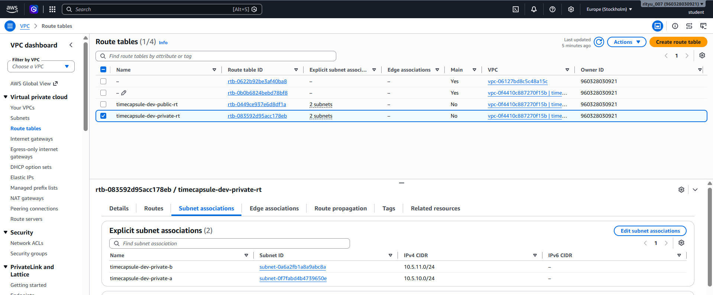
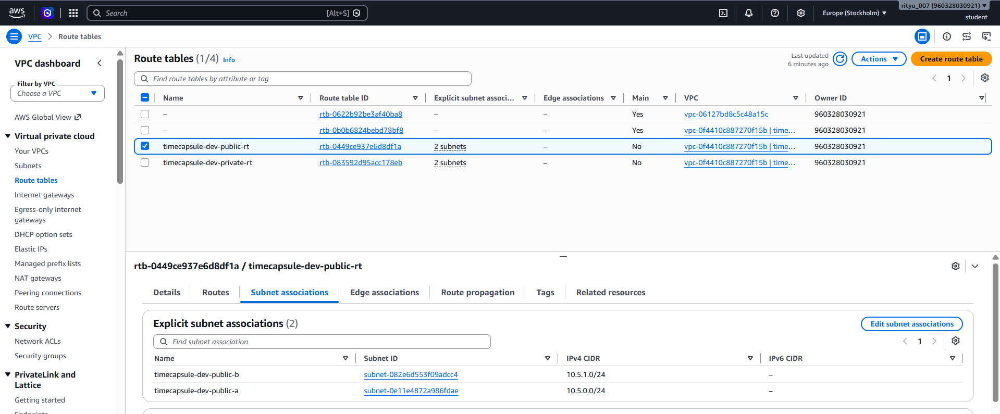
На скриншотах показаны таблицы маршрутизации public-rt и private-rt, включая маршруты и привязанные к ним подсети.

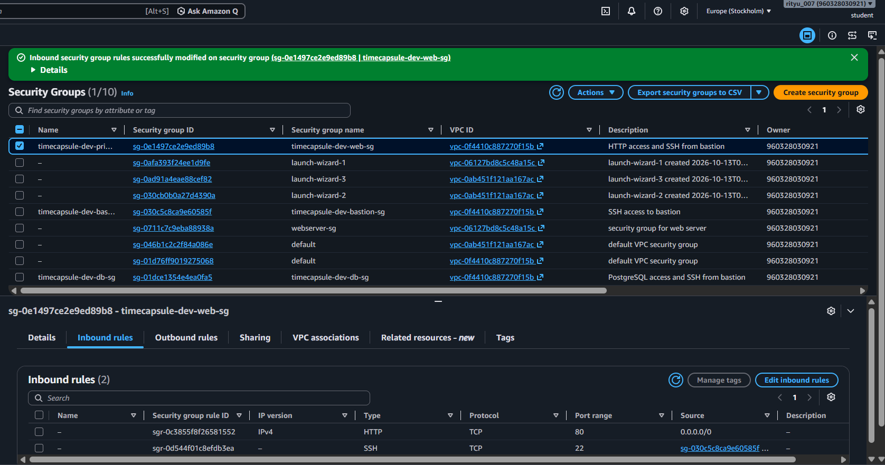
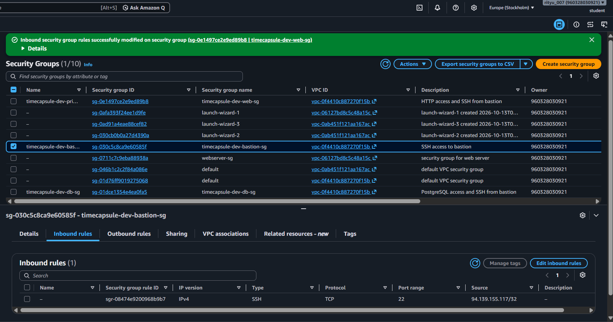
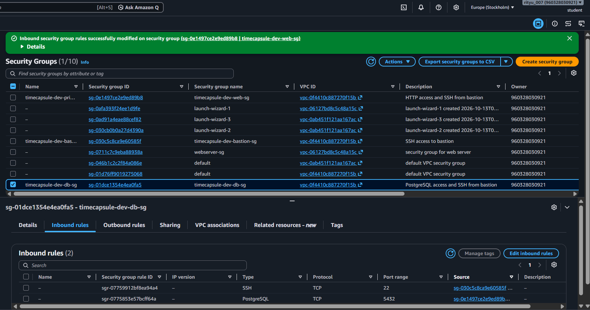
На скриншотах показаны входящие правила трёх групп безопасности для доступа к экземплярам и сервисам.

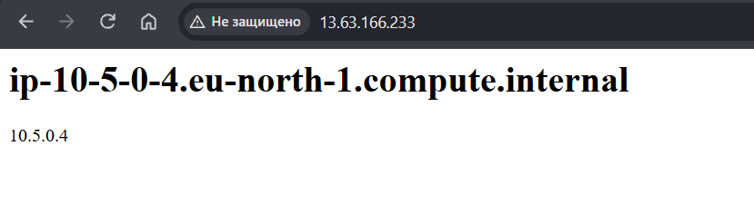
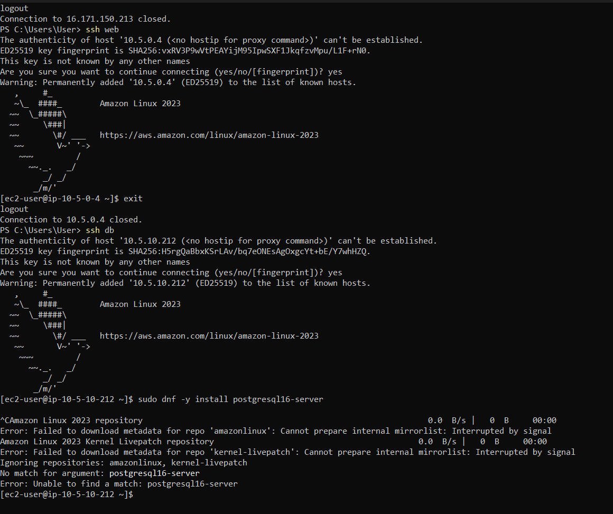
В браузере открыта страница web-server, а в терминале db-server видна установка пакета, которая не завершается из-за отсутствия исходящего доступа.

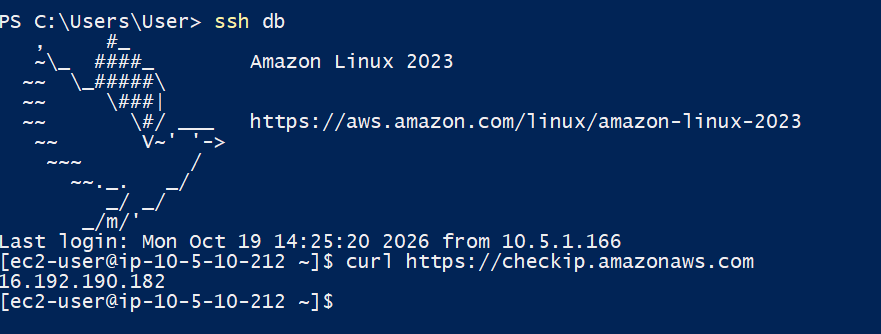
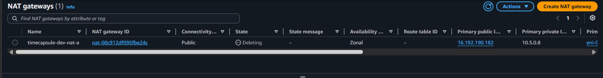
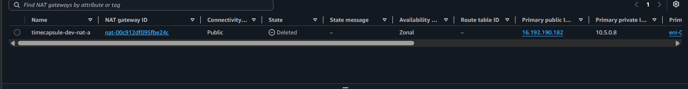
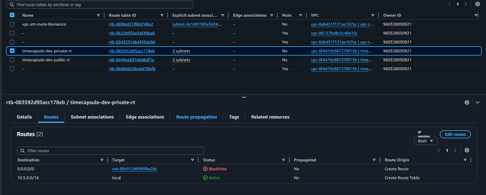
На скриншотах зафиксированы неудачный запрос curl с db-server, маршрут NAT в состоянии Blackhole и удалённый NAT Gateway в списке шлюзов.

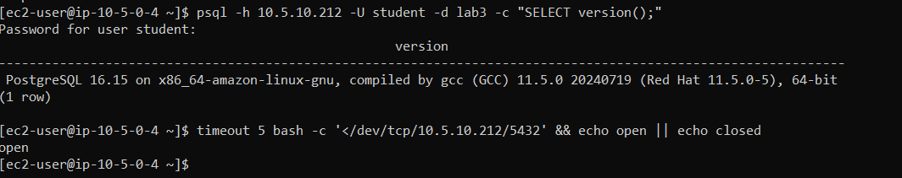
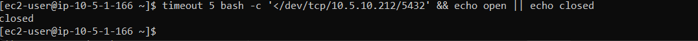
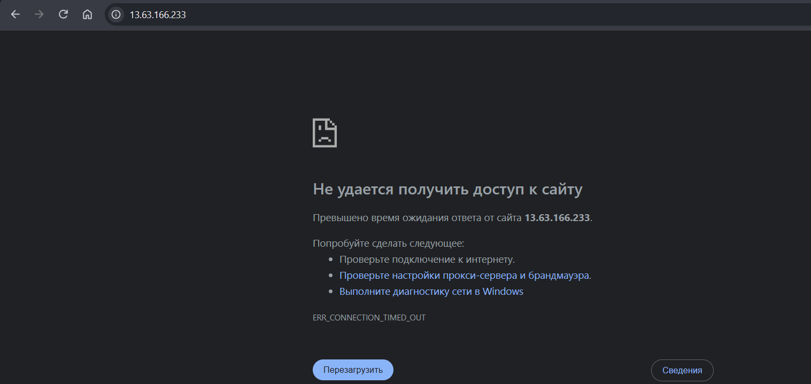
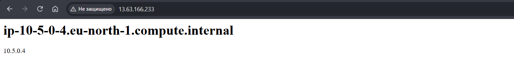
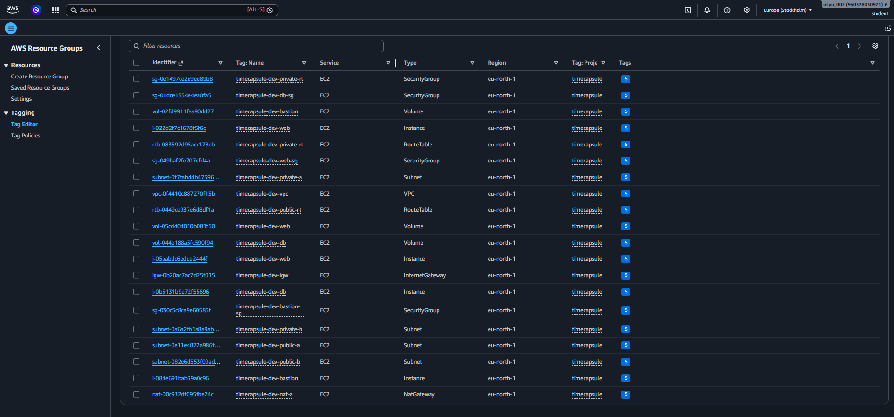

Скриншоты показывают подключение к PostgreSQL с web-server, проверки порта 5432 с web-server и bastion, влияние Network ACL на соединение и ресурсы с тегом Project = timecapsule в Tag Editor.

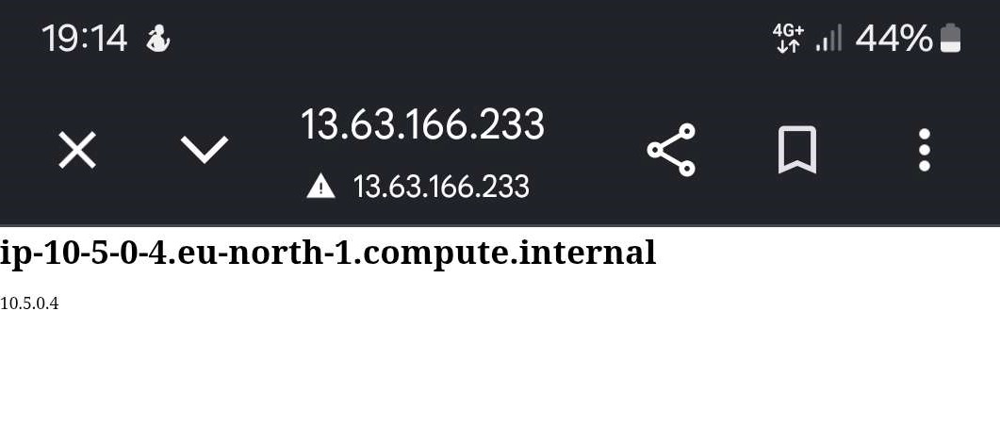
Страница приложения открывается на мобильном устройстве через мобильный интернет по публичному адресу 13.63.166.233.

## Скриншоты продвинутого уровня 

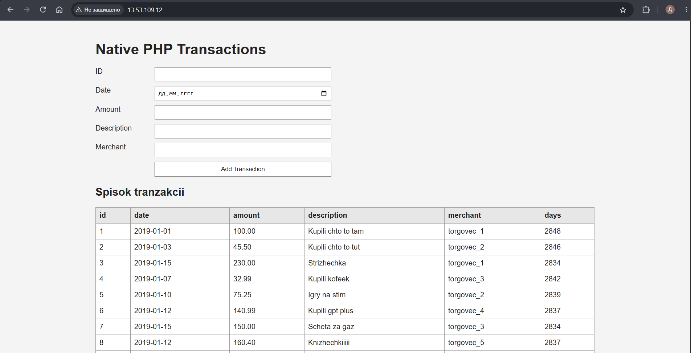
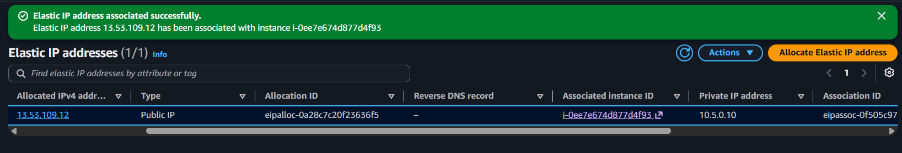
В браузере открыто приложение Native PHP Transactions, развёрнутое и доступное по Elastic IP.

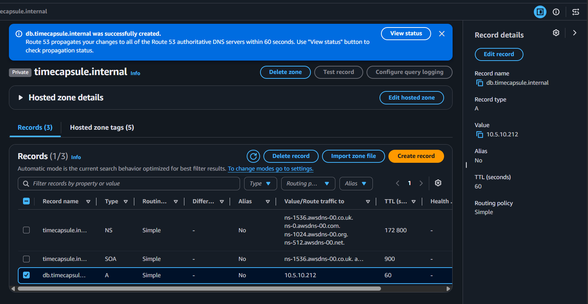

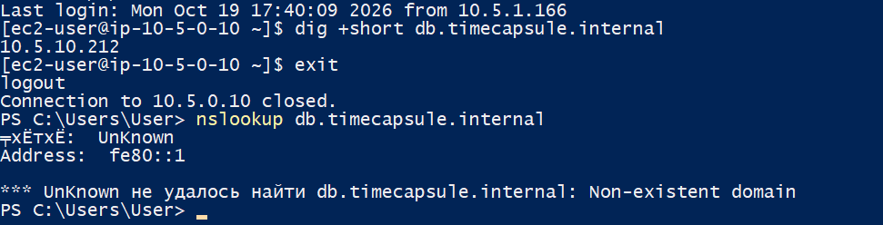
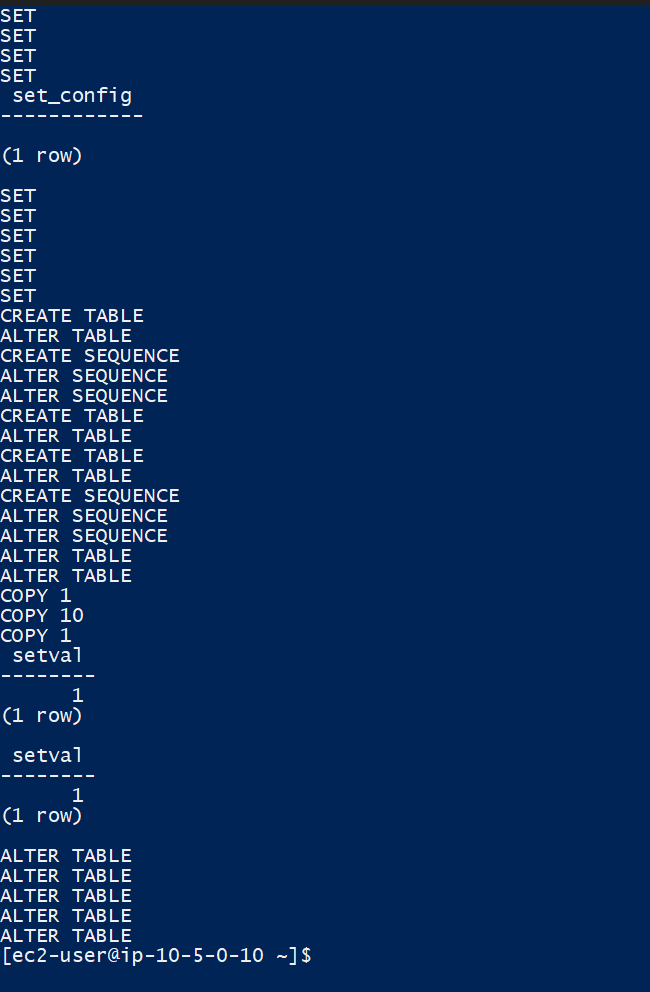
Скриншоты подтверждают DNS-запись db в hosted zone и разрешение имени db.timecapsule.internal с app-server и локального компьютера.

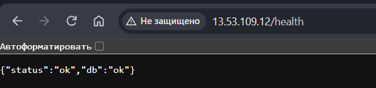
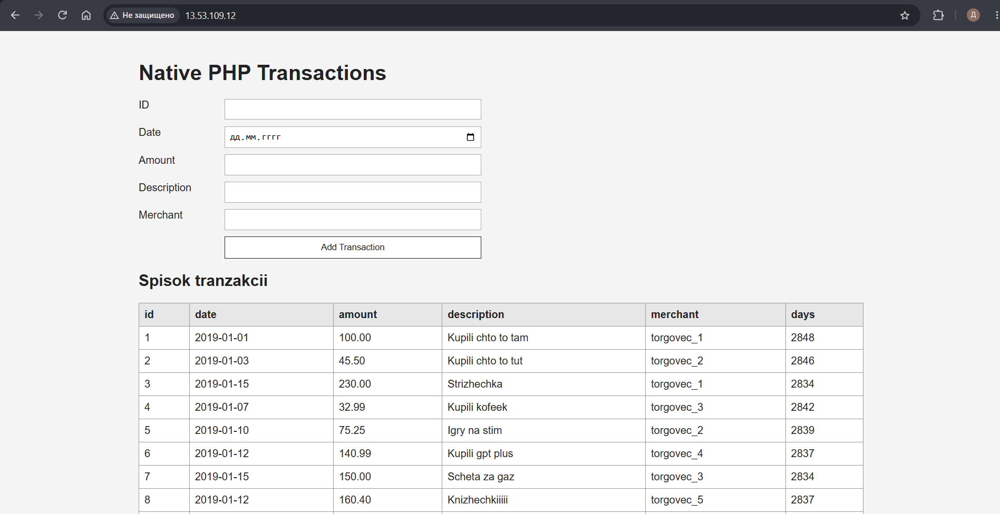
Эндпоинт /health возвращает статус OK, а главная страница отображает приложение Native PHP Transactions и список транзакций.

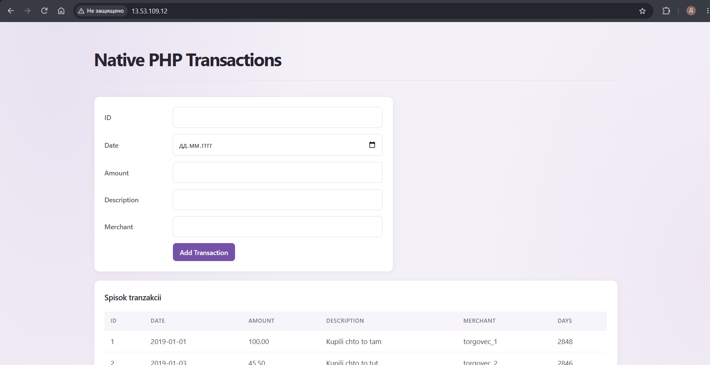
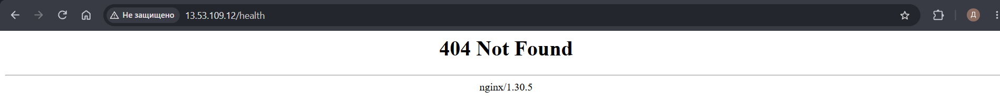
На скриншотах показаны обновлённая надпись LR3 в приложении и ответ /health при остановленной базе данных.

## Архитектура (продвинутый уровень)
 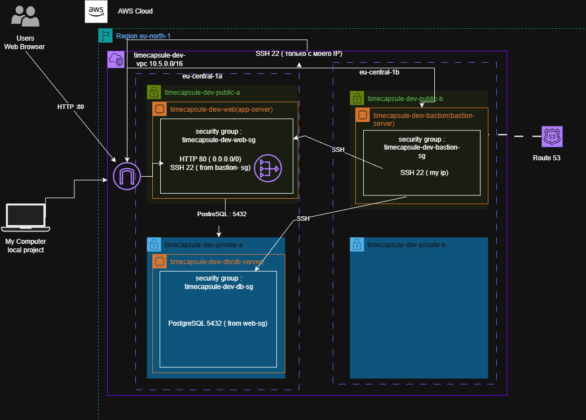

## Ответы на вопросы

***1. Почему доступных адресов не 256? Какие адреса подсети 10.X.0.0/24 занимает AWS и для чего? Сколько ещё подсетей /24 поместится в вашу VPC?*** AWS резервирует первые четыре адреса подсети и последний адрес. доступны адреса 4- 254 В VPC 10.5.0.0/16 помещается 256 подсетей /24.

***2. Является ли подсеть public-a сейчас публичной? Почему?*** Нет, для выхода в интернет ей не хватает записи в таблице маршрутизации

***3. Какой маршрут есть в обеих таблицах, хотя вы его не добавляли? Что он даёт? Куда уйдёт пакет из private-a, адресованный 8.8.8.8?*** Локальный маршрут 10.5.0.0/16 обеспечивает связь внутри VPC. Пакет из private-a будет отброшен, так как маршрута в интернет нет.

***4. Почему в db-sg источником указана группа web-sg, а не адрес веб-сервера или диапазон 10.5.0.0/16?*** Так доступ к базе получают только серверы из web-sg, даже если их IP изменится.

***5. Почему db-server не может скачать пакеты, хотя web-server это делает? Что нужно добавить в сеть, чтобы это стало возможно, и при этом db-server остался недоступным из интернета?*** У db-server нет маршрута для выхода в интернет. Для обновлений нужен NAT Gateway в публичной подсети и маршрут к нему из приватной подсети

***6. Какой адрес вернула первая команда? Сравните его с Elastic IP NAT Gateway. Почему это не адрес db-server?*** Команда вернула Elastic IP NAT Gateway: через него проходит исходящий трафик db-server. У самого db-server публичного IP нет.

***7. Доступ к базе теперь ограничивают три механизма: отсутствие публичного адреса и маршрута в Internet Gateway, Security Group db-sg и файл pg_hba.conf. Что делает каждый из них? Что произойдёт, если ошибиться только в одном?*** Сеть ограничивает доступ извне, db-sg фильтрует подключения, а pg_hba.conf проверяет клиентов PostgreSQL. Ошибка в одном слое может нарушить доступ или ослабить защиту.

***8. Почему PostgreSQL продолжает работать после удаления NAT Gateway? Что придётся сделать, когда на db-server понадобится установить обновления безопасности?*** NAT Gateway нужен для выхода в интернет, а не для связи внутри VPC. Для обновлений нужно временно создать его и добавить маршрут из приватной подсети.

***9. Почему с web-server порт открыт, а с bastion нет, хотя оба сервера в одной VPC и маршрут между ними есть?*** db-sg разрешает доступ от web-sg, а bastion к этой группе не относится.

***10. Почему заблокировано и SSH, и сайт, хотя вы не меняли ни одной Security Group? Почему с телефона сайт открывается? Почему правило должно иметь номер меньше 100?*** Доступ блокирует Network ACL; у телефона другой внешний IP. Правило с меньшим номером проверяется раньше.

***11. Как по тегам найти все ресурсы, которые нужно удалить после окончания проекта? Зачем нужен тег Owner, если аккаунт у вас личный?*** Найдите ресурсы по тегам Project=timecapsule и Environment=dev. Тег Owner показывает, кто отвечает за ресурс и расходы.

***12. Что содержит образ? Какие данные из ЛР2 оказались на app-server без всякой установки? Где сейчас хранится база данных приложения?*** Образ содержит ОС, пакеты и файлы приложения, сохранённые при его создании. База данных хранится отдельно на db-server в PostgreSQL.

***13. Почему Elastic IP нужен app-server, но не нужен bastion? Сколько стоит Elastic IP, пока сервер остановлен, и почему? Когда в следующих работах перед сервером появится балансировщик нагрузки, понадобится ли Elastic IP?*** Elastic IP даёт app-server постоянный адрес; bastion может использовать обычный публичный IP. По тарифу лабораторной Elastic IP стоит около $0.005 в час даже при остановленном сервере. При использовании Application Load Balancer отдельный Elastic IP серверу обычно не нужен.

***14. Зачем для базы в отдельной сети нужен новый сильный пароль, если порт 5432 и так закрыт Security Group?*** Если разрешённый сервер скомпрометируют, пароль всё ещё защитит вход в PostgreSQL.

***15. Почему с app-server имя находится, а с вашего компьютера нет? Что придётся изменить, если db-server пересоздадут с другим адресом?*** Приватная DNS-зона доступна внутри VPC. При смене IP обновите A-запись db.timecapsule.internal в Route 53.

***16. Файлы, которые пользователи прикрепили к капсулам, переехали вместе с образом, а не вместе с базой. Где они лежат? Что с ними будет, если app-server удалить?*** Файлы лежат на диске app-server в каталоге приложения. При удалении сервера они могут потеряться, если диск удалится и резервной копии нет.

***17. Почему в самом deploy.sh ничего менять не пришлось? Почему nat-down.sh должен освобождать Elastic IP только после того, как NAT Gateway удалён?*** deploy.sh использует SSH-алиас app из ~/.ssh/config. Elastic IP освобождают после удаления NAT Gateway и отсоединения адреса.

## Вопросы продвинутого уровня

***18. Как проходит запрос пользователя от браузера до базы данных? Какие маршруты и какие правила фильтрации он проходит на каждом шаге?*** Запрос идёт через Internet Gateway к app-server, затем по локальному маршруту VPC к db-server. На пути его проверяют NACL, Security Groups и pg_hba.conf.

***19. Злоумышленник знает приватный IP db-server. Что ему нужно получить, чтобы подключиться к базе?*** Ему нужны доступ из разрешённой сети и действительные учётные данные PostgreSQL. Одного IP недостаточно.

***20. Чем временный NAT Gateway лучше постоянного и какие неудобства он создаёт?*** Он сокращает расходы, но для обновлений его нужно создать и настроить, а затем удалить.

***21. Как изменится схема, если приложение должно пережить отказ зоны eu-north-1a? Каких ресурсов для этого не хватает?*** Нужны второй сервер приложения в другой зоне, отказоустойчивая база данных и Application Load Balancer в нескольких публичных подсетях.

