# Борисенко Дарья IA2403 ( informatica aplicata )
## Продвинутый уровень  собственное приложение , вариант деплоя : А
https://github.com/rityu-cloud/timecapsule.git

## Порядковый номер: 5

### задание 1 

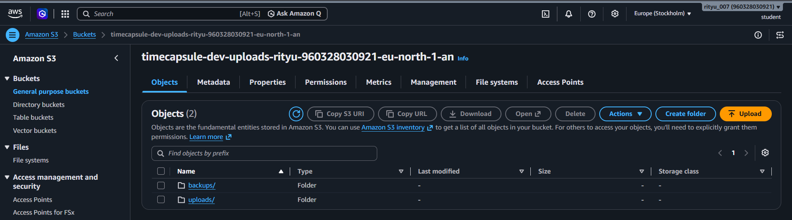
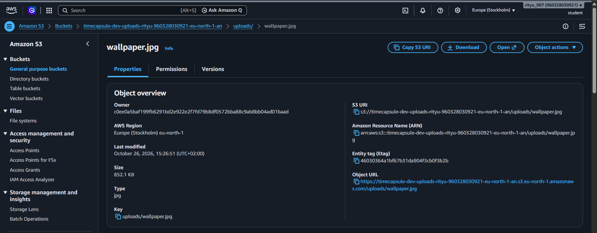

***Какой ключ у картинки? Почему Object URL не открывается, хотя вы владелец бакета? Что на самом деле создала кнопка Create folder?***
Ключ объекта: uploads/wallpaper.jpg. Кнопка Create folder фактически создала объект с таким ключом. Владелец бакета не обязательно может открыть объект публично: Block all public access запрещает такой доступ, поэтому Object URL без авторизации может вернуть AccessDenied.
Ключ объекта uploads/wallpaper.jpg

Владелец бакета не обязательно имеет право на публичный доступ к объекту через браузерВ нашем бакете включён параметр Block all public access, который блокирует публичный доступ. Поэтому при открытии Object URL без авторизации AWS может вернуть ошибку AccessDenied.

### задание 2 

Посмотрите содержимое бакета тремя способами и сравните вывод:

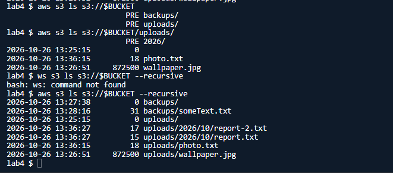

head-object

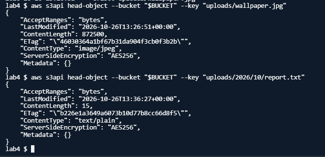

***Почему первая команда ls показывает PRE uploads/ и PRE backups/, а третья показывает полные ключи? Какой Content-Type получил report.txt, хотя вы его не указывали?***
Первая команда aws s3 ls показывает папки верхнего уровня как PRE uploads/ и PRE backups/. Команда с --recursive выводит полные ключи объектов, включая вложенные пути. AWS CLI определил Content-Type: text/plain по расширению report.txt.
Первая команда aws s3 ls показывает PRE uploads/ и PRE backups/, потому что отображает папки верхнего уровня. Третья команда с --recursive выводит полные ключи всех объектов, включая вложенные пути. Файл report.txt автоматически получил Content-Type: text/plain, поскольку AWS CLI определил тип содержимого по расширению .txt.

### задание 3 

политика бакета 

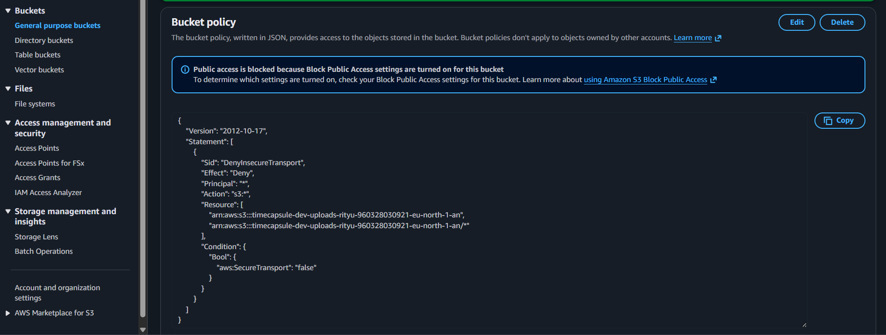

команды проверки 

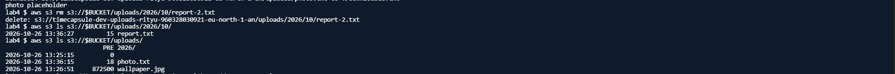
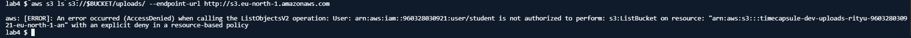

***Почему вторая команда получает AccessDenied, хотя у вас права администратора? Почему Block Public Access не помешал сохранить политику с "Principal": "*"?***
Вторая команда получает AccessDenied, потому что политика бакета запрещает запросы без HTTPS. Явный Deny действует даже при правах администратора. Block Public Access не мешает сохранить политику с Principal: *, потому что она запрещает небезопасные HTTP-запросы, а не открывает публичный доступ.
Вторая команда получает AccessDenied, потому что политика бакета содержит явный Deny для запросов без HTTPS, а явный запрет имеет приоритет даже над правами администратора. Block Public Access не помешал сохранить политику с "Principal": "*", поскольку она не предоставляет публичный доступ, а запрещает небезопасные HTTP-запросы всем участникам.

### заданиче 4 

список версий notes.txt с маркером удаления 

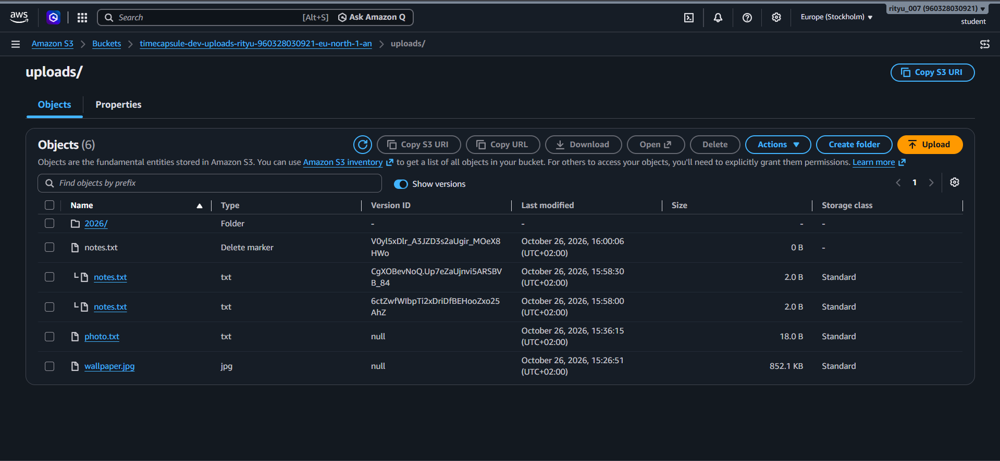

после отката к 1 версии

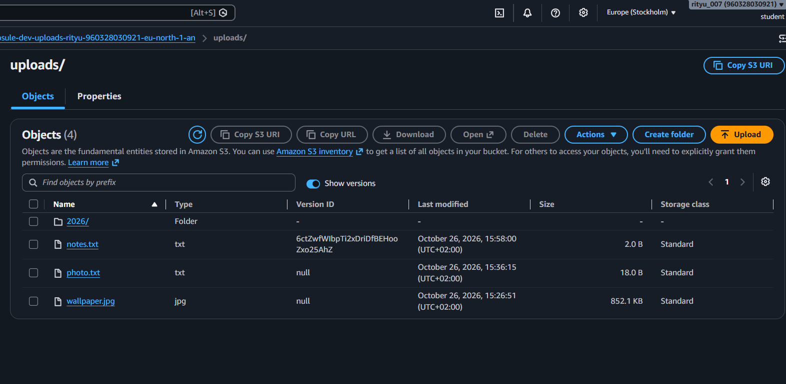

***Чем удаление в шаге 3 отличается от удаления в шаге 5? Какое из них можно отменить? Какой из двух способов защищает от случайного удаления, а какой нужно запрещать приложению?***
В шаге 3 обычное удаление создало Delete marker: файл скрылся, но предыдущие версии сохранились. Удалив маркер, файл можно вернуть. В шаге 5 удалили конкретную версию v2, и отменить это нельзя. Маркер защищает от случайной потери файла, а приложению следует запретить ненужное удаление версий, чтобы сохранить историю.
В шаге 3 обычное удаление создало Delete marker, скрыв файл, но сохранив его предыдущие версии. Такое удаление можно отменить, удалив маркер, и объект снова станет доступен. В шаге 5 удалили конкретную версию `v2`, поэтому для её восстановления это действие отменить нельзя — если версия удалена окончательно, вернуть её через S3 уже не получится. Маркер удаления защищает от случайной потери файла и позволяет восстановить его, а приложению следует запрещать без необходимости удалять конкретные версии объектов, чтобы не уничтожить историю данных.

### задание 5 

схема правила жизненного цикла

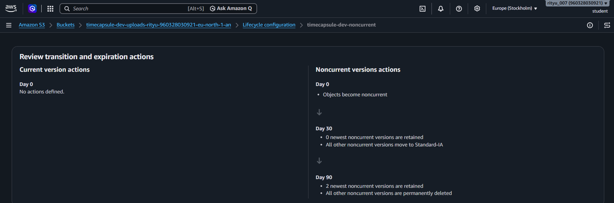

***Как поведёт себя правило для файла, который перезаписывали 10 раз за неделю? Какие версии и когда окажутся в Standard-IA, какие будут удалены? Почему наши маленькие тестовые файлы в Standard-IA не попадут? Что такое незавершённая загрузка частями и почему за неё приходится платить?***
После 10 перезаписей за неделю предыдущие версии станут неактуальными. Через 30 дней они перейдут в Standard-IA, а через 90 дней будут удалены, кроме двух самых новых неактуальных версий. Файлы меньше 128 КБ по умолчанию не переводятся в Standard-IA. Незавершённая multipart-загрузка — это загрузка файла частями, которую не завершили или не отменили. Части занимают место и тарифицируются, поэтому правило удаляет их через 7 дней.
Если файл перезаписывали 10 раз за неделю, S3 сохранит его предыдущие версии как неактуальные: через 30 дней они перейдут в Standard-IA, а через 90 дней будут удалены, кроме двух самых новых неактуальных версий. Маленькие тестовые файлы могут не перейти в Standard-IA, поскольку S3 по умолчанию не переводит объекты размером менее 128 КБ в другой класс хранения. Незавершённая multipart-загрузка — это загрузка большого файла по частям, которая не была завершена или отменена; её части занимают место и тарифицируются, поэтому правило удаляет такие загрузки через 7 дней.

## задание 6 

работающие ссылки 

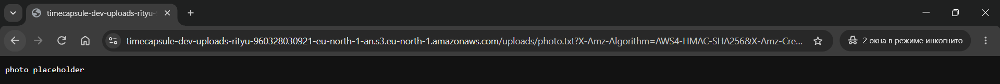
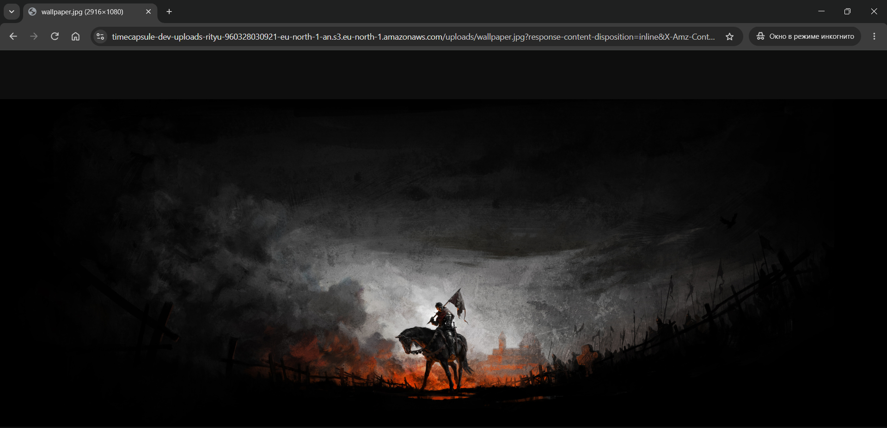

испортили ссылку 

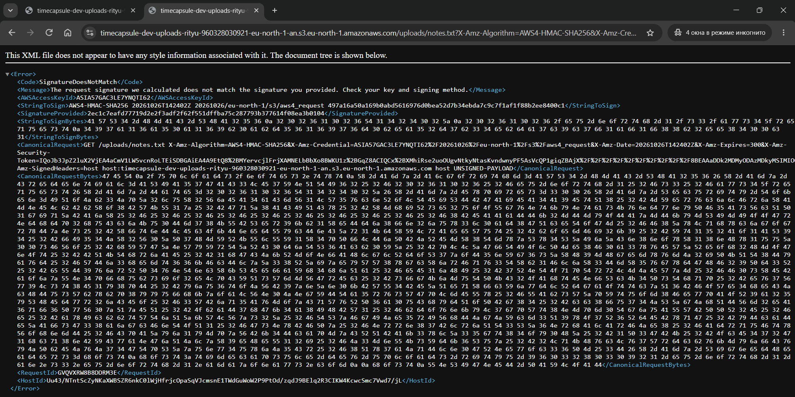

время вышло

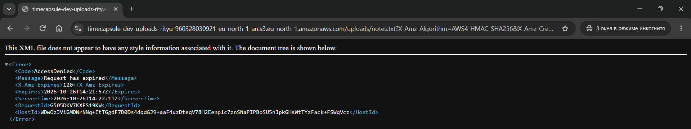

***Какие ошибки вернул S3 в шагах 3 и 4? Почему нельзя получить другой файл, просто поменяв ключ в ссылке? Обращалась ли команда aws s3 presign к S3, когда создавала ссылку?***
В шагах 3 и 4 S3 вернул Request has expired и SignatureDoesNotMatch. Первая ошибка означает, что срок действия ссылки истёк, вторая — что подпись не подходит изменённому адресу. Заменой ключа нельзя получить другой файл: подпись связана с исходным объектом и параметрами запроса. aws s3 presign сформировала URL локально по учётным данным AWS; к S3 обратились только при открытии ссылки.
В шагах 3 и 4 S3 вернул ошибки Request has expired и SignatureDoesNotMatch соответственно. Первая означает, что срок действия ссылки истёк, а вторая — что подпись не соответствует изменённому адресу файла. Нельзя получить другой файл, просто поменяв ключ в ссылке, потому что подпись криптографически связана с исходным объектом и параметрами запроса. Команда aws s3 presign не обращалась к S3 при создании ссылки: она локально формировала подписанный URL с использованием учётных данных AWS. Обращение к S3 происходило только тогда, когда ссылка открывалась в браузере.

## продвинутая часть 

### задание 7 -8

документ политики приложения 

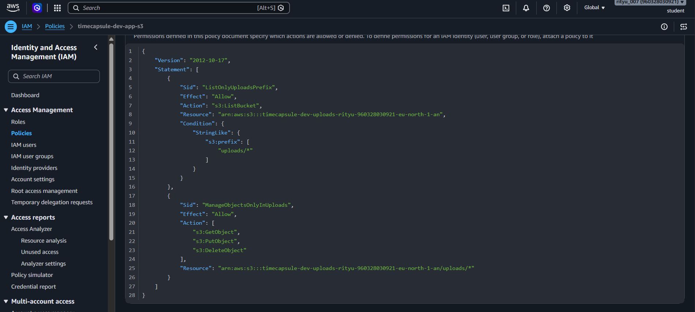

вывод aws sts get-caller-identity от имени тестовой роли

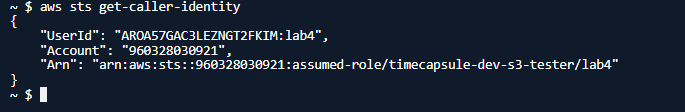

***Почему s3:ListBucket относится к ресурсу "бакет", а s3:GetObject к ресурсу "объект"? Что произойдёт, если перепутать ARN в этих двух правилах?***
Политика доверия определяет, кто может принять роль, а политика прав — какие действия ей разрешены. После команды 9 S3 создал Delete marker, поэтому test.txt можно восстановить, удалив маркер. С правами только на uploads/* и без s3:DeleteObjectVersion злоумышленник может скрыть файлы, но не удалить их версии окончательно. С правом s3:* он мог бы удалять версии тоже; без резервных копий восстановление стало бы невозможным.
`s3:ListBucket` относится к бакету, потому что это действие позволяет просматривать список объектов внутри него, а `s3:GetObject` относится к объектам, поскольку позволяет читать содержимое конкретного файла. Для бакета используется ARN вида `arn:aws:s3:::имя-бакета`, а для объектов — `arn:aws:s3:::имя-бакета/uploads/*`. Если перепутать ARN, политика будет настроена неправильно, и AWS не предоставит ожидаемые разрешения: например, чтение файлов может завершаться ошибкой `AccessDenied`. Поэтому для каждого действия важно указывать правильный тип ресурса.

| №  | Команда                                                                                                         | Ожидаю         | Получил        | Какое правило сработало                                                   |
| -- | --------------------------------------------------------------------------------------------------------------- | -------------- | -------------- | ------------------------------------------------------------------------- |
| 1  | `aws s3 cp test.txt s3://$BUCKET/uploads/test.txt`                                                              | Разрешено      | Разрешено      | Разрешение в политике приложения — `s3:PutObject`                         |
| 2  | `aws s3 ls s3://$BUCKET/uploads/`                                                                               | Разрешено      | Разрешено      | Разрешение в политике приложения — `s3:ListBucket` с условием `s3:prefix` |
| 3  | `aws s3 ls s3://$BUCKET`                                                                                        | `AccessDenied` | `AccessDenied` | Неявный запрет — нет разрешения на список с пустым префиксом              |
| 4  | `aws s3 cp s3://$BUCKET/uploads/photo.txt -`                                                                    | Разрешено      | Разрешено      | Разрешение в политике приложения — `s3:GetObject`                         |
| 5  | `aws s3 ls s3://$BUCKET/backups/`                                                                               | `AccessDenied` | `AccessDenied` | Неявный запрет — `s3:ListBucket` не разрешён для `backups/`               |
| 6  | `aws s3 cp test.txt s3://$BUCKET/backups/test.txt`                                                              | `AccessDenied` | `AccessDenied` | Неявный запрет — `s3:PutObject` разрешён только для `uploads/*`           |
| 7  | `aws s3api list-object-versions --bucket $BUCKET --prefix uploads/`                                             | `AccessDenied` | `AccessDenied` | Неявный запрет — `s3:ListBucketVersions` отсутствует в политике           |
| 8  | `aws s3api delete-object --bucket $BUCKET --key uploads/test.txt --version-id q8QCVwHnehj5KMHBYVucxyJjUCDu1jT3` | `AccessDenied` | `AccessDenied` | Неявный запрет — `s3:DeleteObjectVersion` отсутствует в политике          |
| 9  | `aws s3 rm s3://$BUCKET/uploads/test.txt`                                                                       | Разрешено      | Разрешено      | Разрешение в политике приложения — `s3:DeleteObject`                      |
| 10 | HTTP-запрос к правильному endpoint `eu-north-1`                                                                 | `AccessDenied` | `AccessDenied` | Явный запрет в политике бакета — `DenyInsecureTransport`                  |

***Чем политика доверия роли отличается от политики прав? Что на самом деле произошло с test.txt после команды 9, и можно ли его восстановить? Сможет ли злоумышленник, получивший учётные данные приложения, уничтожить файлы пользователей без возможности восстановления? А если бы в политике было "s3:*"?***
AWS CLI автоматически получил временные учётные данные через IAM Role, назначенную EC2, используя сервис метаданных экземпляра (IMDS). Доверие этой роли разрешает её использование сервису EC2; у тестовой роли доверенной стороной был аккаунт AWS, который разрешил пользователю student вызвать assume-role. Временные данные безопаснее ключа в .env: их не нужно хранить, они автоматически обновляются и ограничены правами роли.
Политика доверия определяет, кто может принять роль, а политика прав — какие действия разрешены тому, кто её принял. После команды 9 файл `test.txt` не был окончательно уничтожен: при включённом версионировании S3 создал маркер удаления, поэтому файл можно восстановить, удалив этот маркер. Злоумышленник с учётными данными приложения не сможет безвозвратно удалить пользовательские файлы, если его права ограничены `uploads/*` и не включают `s3:DeleteObjectVersion`, хотя он может создавать маркеры удаления. Если бы политике выдали `s3:*` на объекты бакета, злоумышленник мог бы удалять и конкретные версии файлов, что при отсутствии резервных копий может сделать восстановление невозможным.

### задание 9 

вывод aws sts get-caller-identity и двух команд aws s3 ls на app-server

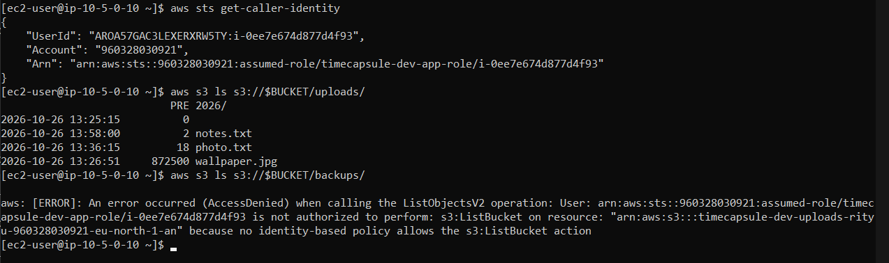

***Где AWS CLI на сервере взял учётные данные, если вы не выполняли aws configure и не вызывали assume-role? Чем политика доверия этой роли отличается от тестовой? Почему такие учётные данные безопаснее ключа доступа в файле .env?***
Да, прав политики timecapsule-dev-app-s3 хватило для aws s3 sync. Команда использовала s3:PutObject для загрузки в uploads/, а для проверки могла использовать s3:ListBucket с разрешённым префиксом и s3:GetObject для сравнения. Флаг --dryrun только показывает план действий. Ограничения на uploads/* хватило; доступ к backups/ и удаление версий не понадобились.
AWS CLI автоматически получил временные учётные данные через IAM Role, привязанную к EC2: сервер получает их от службы метаданных экземпляра (IMDS). Политика доверия этой роли разрешает сервису EC2 принимать роль, тогда как у тестовой роли доверенной сущностью был аккаунт AWS, позволявший пользователю `student` вызвать `assume-role`. Эти временные учётные данные безопаснее ключа в `.env`, потому что их не нужно хранить в файле, они автоматически обновляются и ограничены разрешениями роли.

### задание 10 

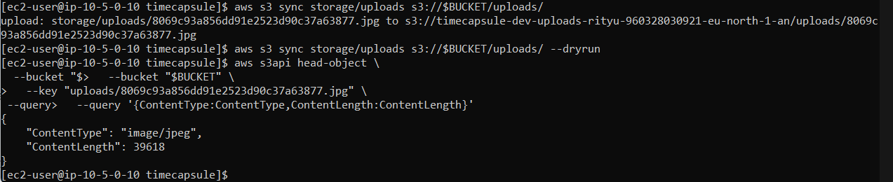

***Хватило ли для aws s3 sync прав политики приложения? Какие из разрешённых действий использовала команда?***
S3 вернул CloudShell код 404, потому что у пользователя есть s3:ListBucket, а серверу EC2 вернул 403, так как в IAM-политике сервера нет этого разрешения. Без s3:ListBucket S3 не сообщает, существует ли объект. Чтобы заменить app-server без потери данных, создайте новый EC2, разверните приложение и подключите его к той же базе PostgreSQL и тому же S3-бакету. После проверки нового сервера старый можно удалить.
Да, для `aws s3 sync` прав политики приложения `timecapsule-dev-app-s3` оказалось достаточно. Команда использовала `s3:PutObject` для загрузки файла в `uploads/`, а при проверке состояния объектов могла использовать `s3:ListBucket` с разрешённым префиксом и `s3:GetObject` для чтения объектов при необходимости сравнения. Правило `--dryrun` само по себе не копирует файлы, а показывает планируемые действия. Ограничение доступа к `uploads/*` сработало: дополнительных прав на `backups/` или удаление версий не потребовалось.

### задание 11 

переписаны функции

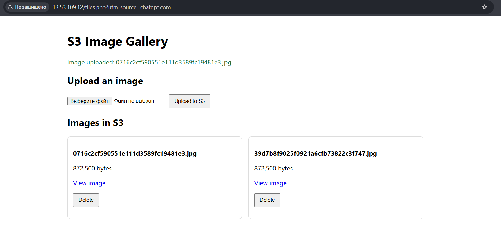
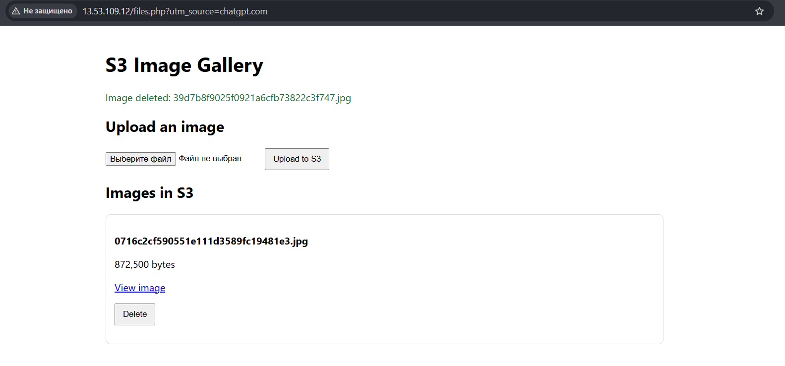

### задание 13

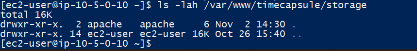
Приложение с вложениями после удаления storage/uploads

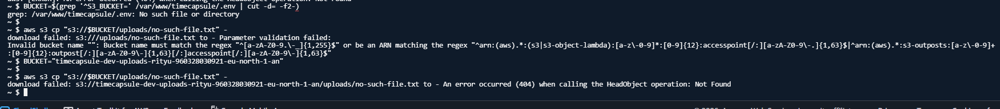

два ответа на запрос несуществующего обьекта

***Почему S3 ответил вам и серверу по-разному, хотя объекта нет в обоих случаях? Зачем S3 так поступает? Что теперь нужно сделать, чтобы заменить app-server новым сервером без потери данных?***

S3 вернул 404 Not Found для CloudShell, поскольку у пользователя есть разрешение s3:ListBucket, а серверу EC2 вернул 403 Forbidden, так как это разрешение было удалено из его IAM-политики. S3 поступает так из соображений безопасности: без s3:ListBucket он не раскрывает, существует ли объект в bucket. Чтобы заменить app-server без потери данных, необходимо создать новый EC2, развернуть на нём приложение и подключить его к той же базе данных PostgreSQL и тому же S3 bucket. Таким образом, пользовательские данные останутся вне сервера, и старый EC2 можно будет удалить после проверки работы нового.

### задание 14

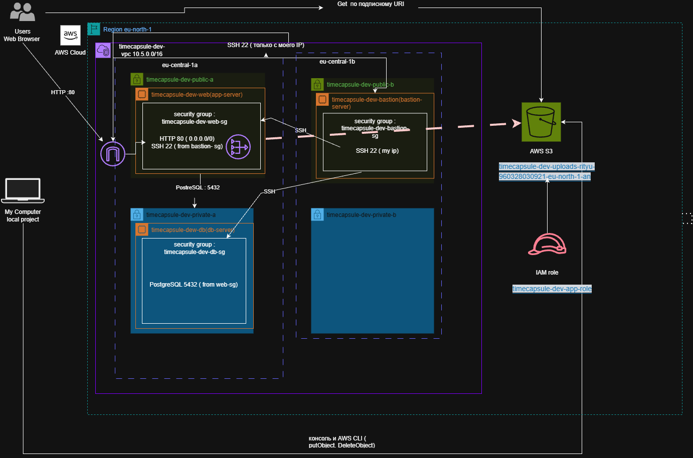

