# Борисенко Дарья IA2403 ( informatica aplicata )
## лабораторная работа номер 5
https://github.com/rityu-cloud/timecapsule.git

# задание 1 

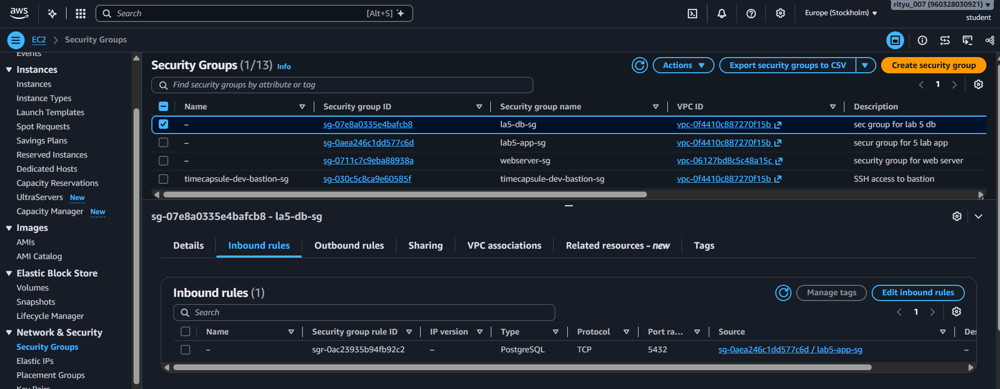
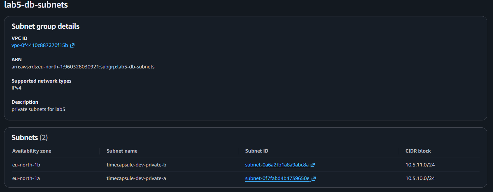

***Почему для ограничения доступа удобнее использовать Security Group источника, а не его IP-адрес? Зачем указывать две подсети, если учебная база будет работать в одной зоне?***

Использование Security Group в качестве источника удобнее, потому что AWS автоматически применяет правило ко всем экземплярам с этой группой, даже если их IP-адреса изменятся. Две подсети в разных Availability Zones нужны для отказоустойчивости и возможности переноса базы в другую зону при сбое. Даже если учебная база работает только в одной зоне, RDS требует минимум две подсети в разных зонах для создания DB Subnet Group.

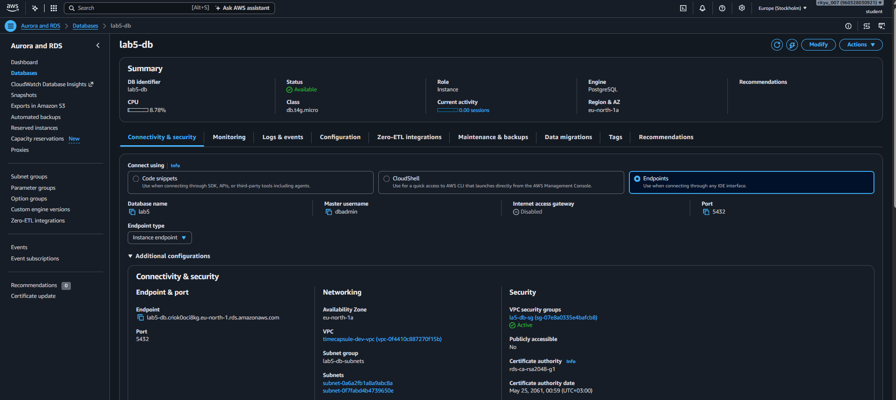
# задание 2

***Как убедиться, что база принимает подключения только с нужного сервера? Почему для неё выбрана зона eu-central-1a? От чего защищает deletion protection, а от чего нет?***

Убедиться в ограничении доступа можно, проверив Security Group: входящий TCP-порт 5432 должен разрешать подключения только от lab5-app-sg, а затем проверить подключение с разрешённого и постороннего сервера. Зона eu-central-1a выбрана для размещения основной базы данных в определённой Availability Zone (в нашей конфигурации фактически используется eu-north-1a). Deletion protection защищает от случайного удаления экземпляра RDS через AWS, пока эта функция включена. Однако она не защищает от потери или повреждения данных, ошибок SQL-запросов и сбоев самой базы данных.

# задание 3 
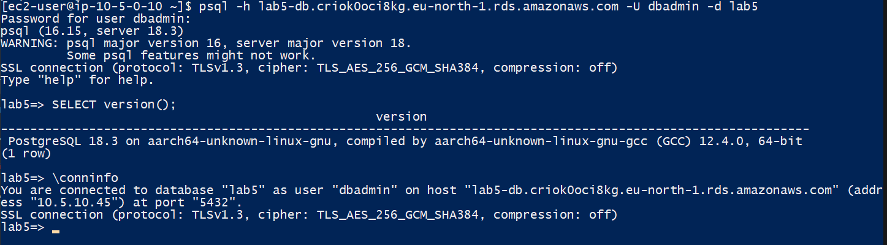
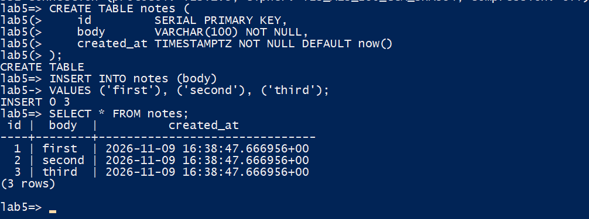
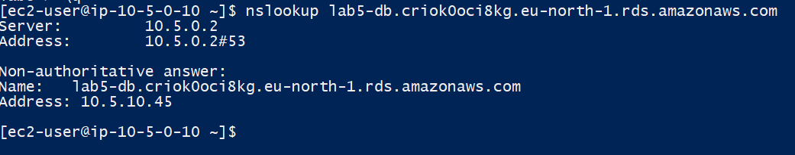

# задание 4 

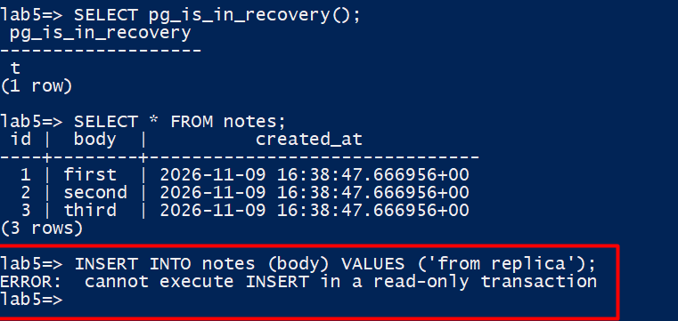
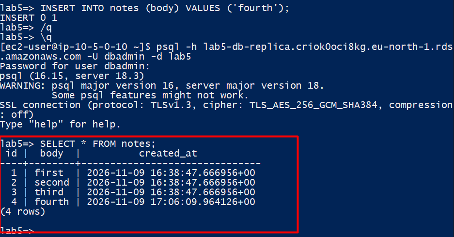
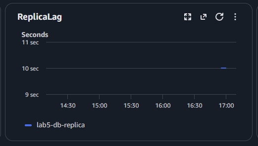

***Почему INSERT на реплике не выполнился? Чем реплика для чтения отличается от резервного экземпляра Multi-AZ?***
INSERT на реплике не выполнился, потому что Read Replica работает в режиме только для чтения и получает изменения от основной базы данных. В отличие от неё, резервный экземпляр Multi-AZ предназначен для обеспечения отказоустойчивости: он автоматически заменяет основную базу при сбое, но не используется для обработки обычных запросов на чтение.

# задание 5 

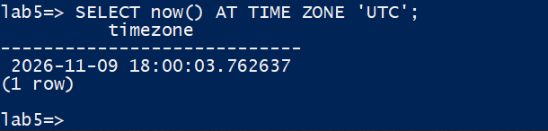
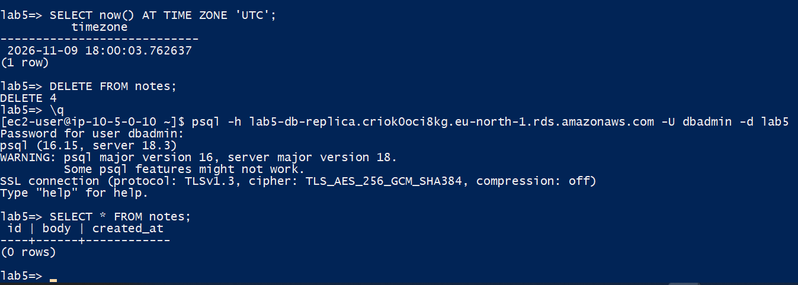

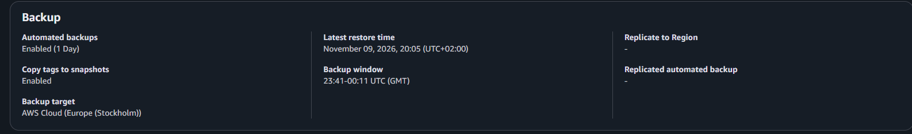

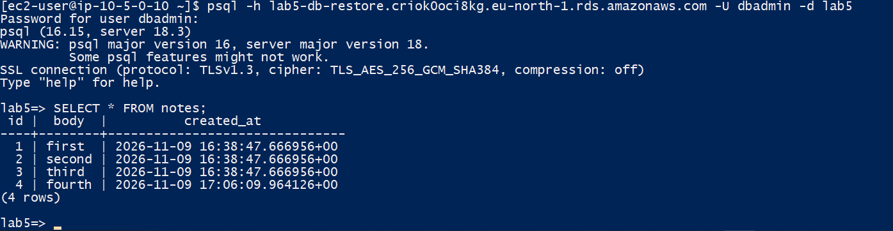

***Почему реплика не спасла данные? Почему восстановление создаёт новую базу, а не откатывает старую?***

Read Replica не спасла данные, потому что она автоматически копирует изменения с основной базы, включая удаление записей. Point-in-Time Recovery (PITR) создаёт новую базу, чтобы восстановить данные на выбранный момент, не изменяя исходную базу и не рискуя потерять её текущее состояние.

## Продвинутый уровень 

***Какие параметры базы приложения вы выбрали бы иначе для рабочей системы с реальными пользователями? Почему?***

Для рабочей системы я бы выбрала более производительный класс экземпляра RDS, например db.t3.small или выше, в зависимости от нагрузки. Также включила бы Multi-AZ для обеспечения высокой доступности и автоматического переключения на резервную базу при сбоях. Увеличила бы срок хранения резервных копий и настроила мониторинг производительности и уведомления о проблемах. Это позволит повысить надёжность, безопасность и стабильность работы приложения.

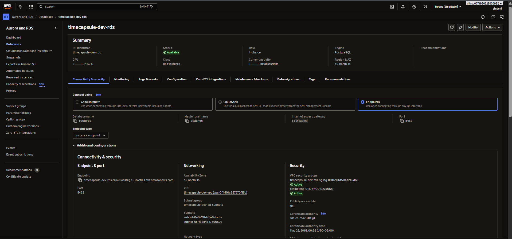
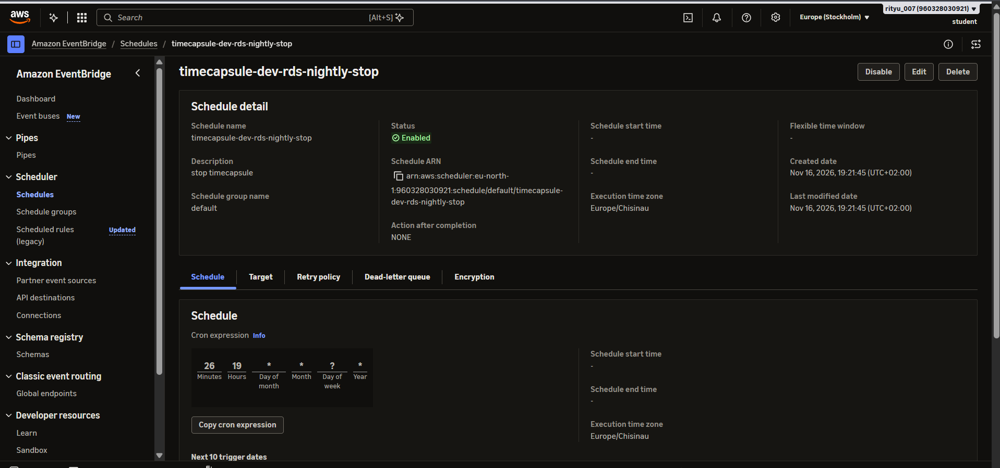

## задание 7 

***Зачем расписанию своя роль, если вы и сами можете остановить базу? Почему роль может остановить только одну базу?***

Расписанию нужна отдельная роль, чтобы EventBridge Scheduler мог выполнять действия от имени AWS-сервиса, не используя личные учётные данные пользователя. Роль ограничена одной базой с помощью ARN ресурса в IAM Policy, поэтому расписание не сможет случайно остановить другие базы данных. Это принцип минимальных привилегий: каждому сервису предоставляются только те разрешения, которые необходимы для его работы.

## задание 8 
***Почему приложению нужен отдельный пользователь, а не dbadmin?***

Приложению нужен отдельный пользователь, чтобы ограничить его права доступа к базе данных и повысить безопасность. dbadmin обладает административными полномочиями, поэтому его использование приложением создаёт риск случайного изменения или удаления важных данных. Отдельный пользователь timecapsule позволяет реализовать принцип минимальных привилегий и изолировать работу приложения от администрирования базы.

## задание 9 
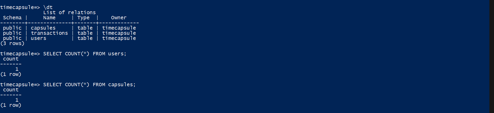
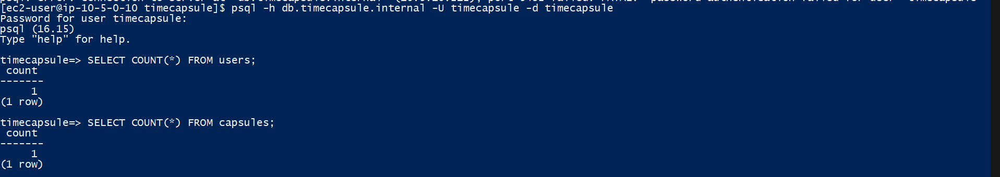
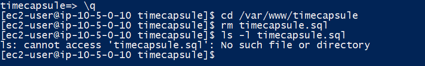

## задание 10 
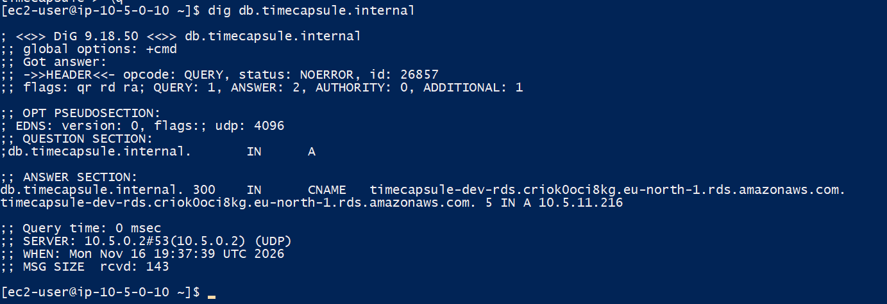

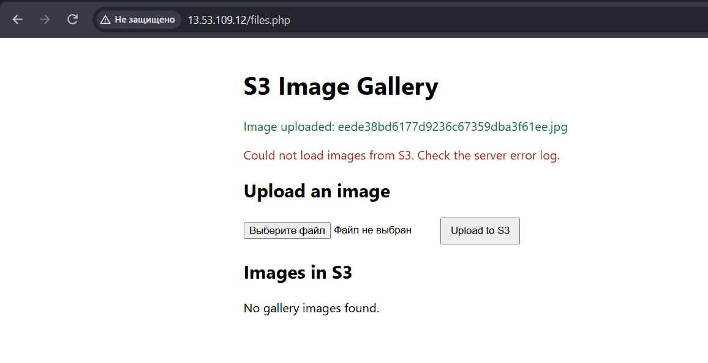

После удаления timecapsule-dev-db

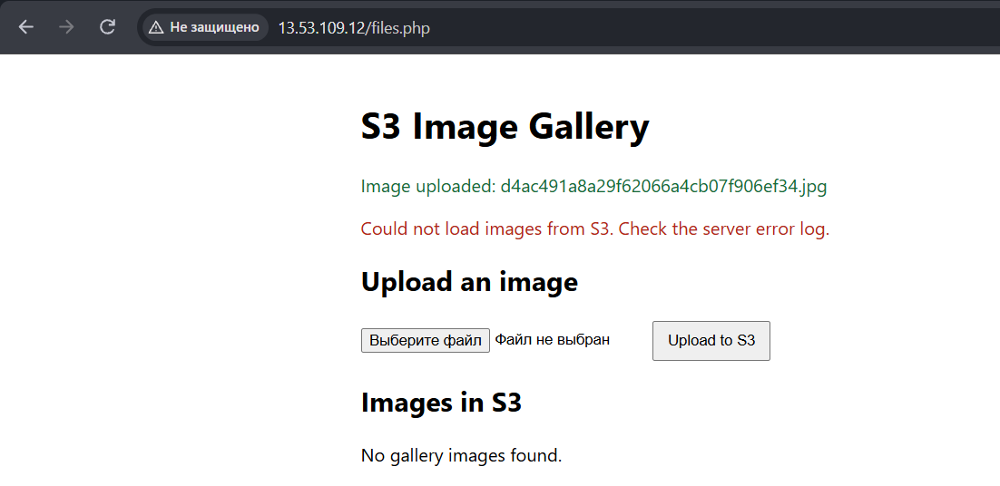
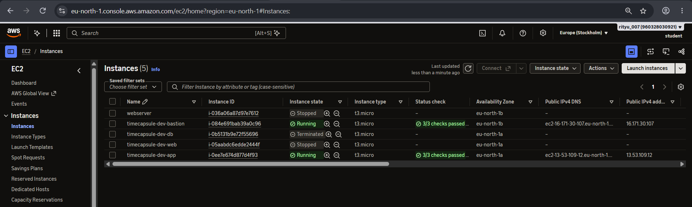

*** Почему не пришлось менять DB_HOST? Какие обязанности из ЛР3 перешли к AWS, а какие остались за вами?***

DB_HOST не пришлось менять, потому что в ЛР3 приложение уже обращалось к базе через DNS-имя db.timecapsule.internal, а мы изменили только DNS-запись, направив её на RDS вместо старого db-server. AWS взял на себя управление инфраструктурой базы данных: размещение, обслуживание, резервное копирование и обеспечение доступности RDS. За нами остались настройка приложения, управление пользователями и паролями базы данных, настройка прав доступа, подключение через SSL и проверка корректности работы приложения.

## задание 11 

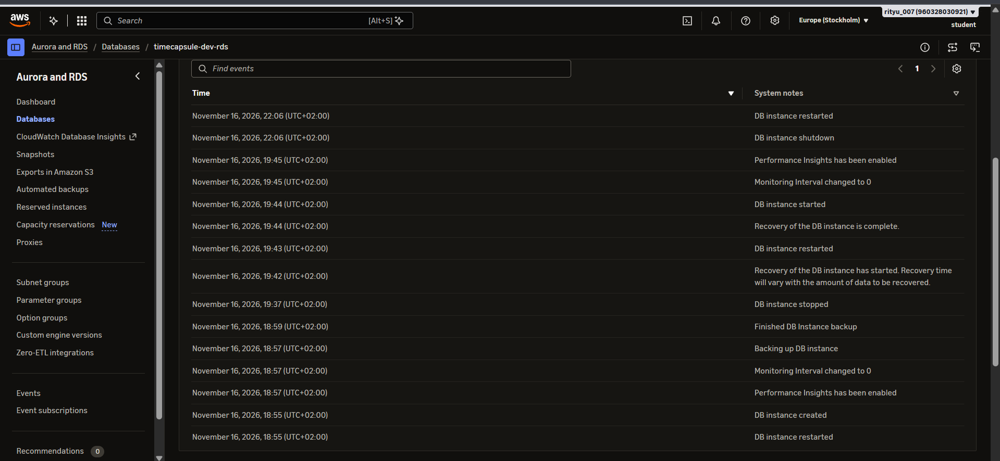